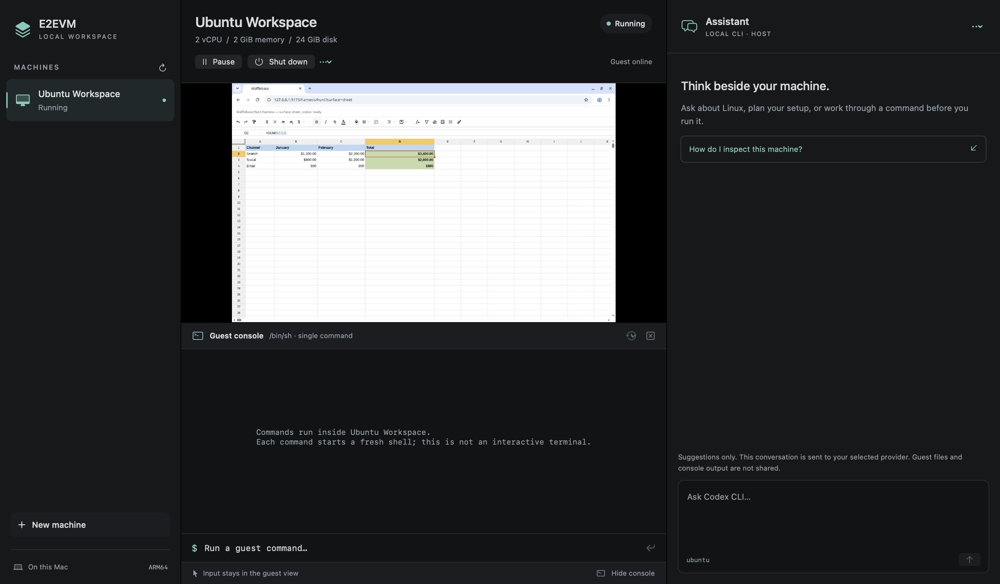

# E2EVM

https://github.com/user-attachments/assets/97017c14-0837-447a-b53c-8ba10b4b690e

**E2EVM is an open-source local VM workspace for AI agent browser testing on Apple Silicon Macs.** Run headed Playwright tests and browser automation on a separate guest desktop while you keep using your Mac.

You're scrolling X, replying to a message, or doing something else. Then your agent starts an E2E run, and a browser jumps in front of you and steals focus. Give the tests their own desktop: E2EVM runs the browser and test commands inside a VM, while you keep using your Mac.

<a name="get-started-with-a-prompt"></a>
<a name="build-and-open-your-first-machine"></a>

## Just paste this prompt

Paste this into your coding agent:

```text
Set up E2EVM for me by following this guide:
https://raw.githubusercontent.com/taejs/e2evm/feat/vm-workspace/docs/install.md
```

Requires an **Apple Silicon Mac with macOS 14+**. This preview builds from source; the agent can check prerequisites and guide setup. Prefer the terminal? See [manual installation](docs/install.md).

Once setup is done, ask for the work:

```text
Run this app's E2E checks in E2EVM while I keep using my Mac.
Send me the results and screenshots.
```

## Your tests get a desktop

Keep a real VM desktop, guest command console, and AI conversation in one native Mac window. Linux machines can install a desktop, Chrome, Python tools, Node.js, and Playwright on first boot. Every optional component starts selected and can be turned off. Choose an existing Codex CLI, an Ollama server, or an OpenAI-compatible chat API in the right panel.



## What can run over there?

| You keep… | The VM handles… |
| --- | --- |
| Scrolling X or reading | A headed E2E run, with results and screenshots |
| Working on something else | Reproducing a UI bug and checking the fix |
| Using your usual browser | A separate, persistent test login |
| Messaging or taking a break | A browser reporting or download task |

[Explore six workflows and copyable prompts](docs/use-cases.md). Bring your app or browser task; the recipes explain what each one needs. [Share your own workflow](https://github.com/taejs/e2evm/issues/new?template=use-case.yml).

## What you can do

- Create separate, named machines and start, pause, resume, or shut them down.
- Browse in a visible guest Chrome window with a persistent browser profile.
- Run commands inside the guest and inspect output, exit status, and timeouts.
- Ask an assistant follow-up questions, select API models, and cancel a response.
- Use the same profile, lifecycle, command, and chat operations from a Rust CLI.

The native shell uses SwiftUI, AppKit, and Apple's Virtualization framework. Rust owns profiles, preparation, guest command transport, and assistant connections. The app runs Linux and macOS guests on **Apple Silicon with macOS 14 or newer**. macOS guests require manual first-run account setup and connection bootstrap; see the [macOS guide](docs/macos.md). It is an early source release; there is no notarized installer or automatic updater.

<details>
<summary>Build and open your first machine manually</summary>

### Build from source

Install [Rust](https://www.rust-lang.org/tools/install) stable (1.85 or newer), [Xcode Command Line Tools](https://developer.apple.com/xcode/resources/), and [Node.js](https://nodejs.org/en/download) 22.15 or newer on the Mac. Node is used to decompress the Ubuntu boot kernel. Python 3 is needed for contributor tests. Preparation and first boot need internet access and room for a 24 GiB sparse disk, downloaded images, and build output. The sparse disk grows as the guest writes data.

```sh
git clone https://github.com/taejs/e2evm.git
cd e2evm
sh scripts/build-macos.sh
export PATH="$PWD/dist/E2EVM.app/Contents/MacOS:$PATH"

e2evm profile create ubuntu --name "Ubuntu Workspace"
e2evm prepare ubuntu
e2evm start ubuntu
e2evm app
```

The default machine has 2 CPUs, 2 GiB memory, and a 24 GiB disk. First boot installs the desktop and browser tools, which can take several minutes. The command worker can become available before the desktop finishes. Chrome opens the included welcome page when setup completes. The desktop's **New machine** and **Prepare Linux** controls provide the same workflow.

```sh
e2evm exec ubuntu -- e2evm-browser https://example.com
e2evm exec ubuntu -- python3 --version
e2evm run ubuntu 'cd ~/Workspace && .venv/bin/python -m playwright --version'
e2evm pause ubuntu
e2evm resume ubuntu
e2evm stop ubuntu
```

`start` launches the workspace in the background so an agent does not take focus from your current app. `app` brings the window forward and enters full screen on its first presentation. The console starts collapsed; use **Show console** or **⌘J** to open it, and **⌃⌘F** to leave full screen. `stop` requests a clean shutdown; check `e2evm status ubuntu` until the machine is stopped. Closing the window keeps guests running. Reopen it with `e2evm app`. Quitting is refused while a machine is active.

</details>

## Give an E2E agent its own workspace

Ship the test, keep working on your Mac. The [agent kit](docs/agents.md) includes two portable skills, project instructions, and copyable prompts for an existing coding agent:

| Skill | What it handles |
| --- | --- |
| [`e2evm-setup`](skills/e2evm-setup/SKILL.md) | Build or locate the app, prepare a dedicated Linux VM, and verify the browser connection. |
| [`guest-e2e`](skills/guest-e2e/SKILL.md) | Run application tests, install guest dependencies, and return assertions with inspected screenshots. |

Install both, or select just the one you need, with the [skill installer](docs/agents.md#install-selected-skills). Screenshot delivery is required for a completed report; a capture failure must be reported as incomplete evidence.

The [instructions](examples/agent-instructions.md) can be added to a project's `AGENTS.md` or `CLAUDE.md`. The [prompts](examples/prompts.md) cover a smoke test, a complete application flow, and missing dependencies. Your agent invokes the CLI; this does not turn the assistant chat panel into an automatic tool runner.

For a minimal Linux machine, use `--without all`. To omit selected tools, use `--without node,playwright`. Turning off a prerequisite also turns off its dependents. The core connection runtime remains available. See [setup choices](docs/usage.md).

## Common questions

**Does the browser take over my Mac?** The test browser and commands run inside the VM. Agent-triggered startup keeps your current app in focus; open the workspace when you want to watch.

**Does my agent run inside the VM?** Your existing coding agent invokes E2EVM's host CLI to run guest commands. The optional chat panel gives advice and does not execute it automatically.

**What do I need?** An Apple Silicon Mac with macOS 14 or newer. This preview builds from source; the supplied setup and testing skills target a dedicated Ubuntu VM.

[Read all 10 answers](docs/faq.md), including screenshots, local development servers, macOS guests, scheduled runs, and security boundaries.

## Connect an assistant

Codex is the default and uses your installed CLI and its existing sign-in. E2EVM does not install or authenticate it. Select a different connection in the assistant's settings, or configure one from the terminal:

```sh
e2evm profile connection ubuntu ollama --endpoint http://127.0.0.1:11434
e2evm assistant models ubuntu
e2evm profile connection ubuntu ollama --endpoint http://127.0.0.1:11434 --model YOUR_MODEL_ID
e2evm chat ubuntu 'How can I check the Python version in my guest?'
```

Ollama must already be running with a model installed. For compatible services, configure the service's base URL and model; the desktop accepts an optional API key held only in memory for the app session. See [assistant connections](docs/assistant.md) for Codex setup, OpenAI-compatible examples, supported protocols, privacy, and cancellation.

Assistant replies are suggestions. They do not run guest commands. Conversations live in the app session and are sent to the selected provider; guest files, browser sessions, screenshots, and console output are not attached automatically.

## Learn more

- [macOS guests and Apple licensing](docs/macos.md)
- [Agent skill, instructions, and prompts](docs/agents.md)
- [Frequently asked questions](docs/faq.md)
- [Use cases and automation recipes](docs/use-cases.md)
- [Usage and troubleshooting](docs/usage.md)
- [Architecture and isolation](docs/architecture.md)
- [Design references](docs/design.md)
- [Recorded validation and known limits](docs/validation.md)
- [Contributing](CONTRIBUTING.md), [security](SECURITY.md), and [community conduct](CODE_OF_CONDUCT.md)

The console runs individual commands, not an interactive terminal. Windows guests, snapshots, disk import, automatic assistant actions, and cross-platform host backends are not implemented. Native screenshot capture has platform rendering limits; see the validation record before relying on it for automation.

E2EVM source is [MIT licensed](LICENSE). Ubuntu, Chrome, Apple frameworks, and other dependencies have their own licenses; see [dependencies](docs/dependencies.md). Chrome is downloaded separately into the guest during setup and is not covered by E2EVM's MIT license.
