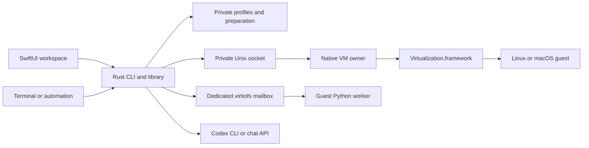

# Architecture

E2EVM is a Rust application with a native macOS presentation and virtualization layer. Rust and Swift have separate responsibilities; using Rust does not replace Apple's hypervisor API.

## Responsibilities

| Component | Owns |
| --- | --- |
| `src/profile.rs`, `src/safe_fs.rs` | Validated profile IDs, private storage, atomic writes, pinned mailbox directories, and advisory locks |
| `src/provision.rs` | Ubuntu artifact verification, fresh disk preparation, kernel extraction, and cloud-init seed generation |
| `src/bridge.rs` | Native app launch and versioned request/reply transport |
| `src/guest.rs`, `guest/worker.py` | Expiring guest requests, bounded output, deadlines, and result identity |
| `src/assistant.rs`, `src/assistant_api.rs` | Codex subprocess supervision and text-streaming API adapters |
| `platform/macos/` | Native workspace, real VM state, VM display and input, and per-profile UI state |
| `guest/setup.sh` | Selected Linux desktop/browser/development tools and connection service |
| `guest/setup-macos.sh` | Manual macOS guest bootstrap, selected tools and login worker |
| `platform/macos/MacOSProvisioner.swift` | Apple restore-image compatibility, fresh macOS identity/disk and installation |

One native app process owns the machine objects and their views. It does not send a framebuffer between separate profile processes. The desktop launches Rust CLI subprocesses for profile, guest, and assistant operations. VM control returns through a private Unix socket to the native process, where the main queue calls Virtualization.framework. A VM state label comes from framework state or a pending shutdown request, not a timer that assumes success.

Closing the window retains running machines. Opening the workspace again reuses the app. Quitting is refused while a machine or preparation is active. Profile selection changes the visible VM and the associated command/chat state.

## Profiles and ownership

The default root is `~/Library/Application Support/E2EVM`; `E2EVM_HOME` selects a separate root. Profile directories contain configuration, disk and boot artifacts, the mailbox, and assistant working storage. The native app holds a process-wide lease, a per-profile lease, and a sidecar lease keyed by disk device/inode identity. The disk's own file is left to Virtualization.framework's image lock: holding a separate `flock` on it would prevent the framework storage service from opening it.

Profile IDs are restricted to lowercase letters, digits, and hyphens. Reads are bounded and mutable protocol paths reject symlinks. Guest request/reply operations pin directory descriptors so replacing an ancestor cannot redirect later operations to an arbitrary host location. These checks defend the protocol boundary; they are not a security boundary against other host processes with the same user's privileges.

## Guest startup and command path

Preparation downloads the pinned Ubuntu ARM64 cloud image, kernel, and initrd and validates their SHA-256 sums. It creates a fresh sparse disk and a cloud-init seed. The Linux kernel boots directly through `VZLinuxBootLoader`. The guest receives NAT networking, a 1440 × 900 virtio graphics display, a virtual keyboard and pointer, and two shares:

| Share | Guest path | Access |
| --- | --- | --- |
| Profile mailbox | `/mnt/harbor` | Read/write |
| Packaged setup kit | `/mnt/harbor-kit` | Read-only |

The guest worker starts before graphical setup finishes. Commands run as the ordinary `harbor` user with an explicit argument vector. `run` deliberately invokes a shell inside the guest. Each request has an ID and expiry; it is consumed before execution and is not automatically retried. Output and duration are bounded. A missing result is an unknown outcome, not evidence that nothing ran.

The console is a command runner, not a PTY. It cannot interact with a password prompt or a long-lived terminal session. The VM desktop provides the graphical browser; no host WebView is substituted for it.

## Browser workstation

With the default Linux setup, first boot installs Openbox, LightDM, Chrome, Python, Node.js, and a Python Playwright environment. Chrome uses a guest-owned persistent profile and listens for debugging connections only on guest loopback. The host browser profile, cookies, and account sessions are not imported. Setup has a completion marker and a systemd retry path for interrupted installation.

## Assistant boundary

The right panel supports a locally installed Codex CLI and two HTTP text-streaming formats. Profile connection metadata is durable; desktop conversation history and entered API keys stay in the app session. Assistant turns run on the host and can continue while the VM is stopped.

The assistant receives submitted conversation text and profile identity. It has no automatic VM control tools. Guest output is not silently appended to a prompt. Users may review a suggestion and separately run a guest command. See the [assistant contract](assistant.md) and [security policy](../SECURITY.md) for exact limits.

## Platform scope

The core's fixture tests run on Linux and macOS. The native backend and provisioning flow currently require Apple Silicon/macOS 14+. Supporting another host platform requires a VM backend and display/input integration; portable Rust code alone does not provide that support. Linux and macOS guests are supported; macOS requires manual first-run setup and guest connection bootstrap. Snapshotting, arbitrary disk import, remote machines and Windows guests are outside this release.

## Guest operating systems and optional setup

Version-1 profiles without `guest_os` or `setup` remain Linux profiles with all optional components enabled. New profiles persist both choices. Preparation is separate from guest readiness: macOS installs an Apple restore image, then the user completes Setup Assistant and the guest-only bootstrap. Native installation runs in a separate signed process while Rust holds the profile lease; only successful fresh staging artifacts are promoted.

Each profile receives a read-only kit containing its selected setup flags. The Linux worker is base infrastructure; desktop, Chrome, Python development tools, Node.js, and Playwright can all be omitted. Disabling prerequisites also disables dependents at creation. macOS includes its OS desktop and needs a Python runtime for its ordinary-user connection worker.
