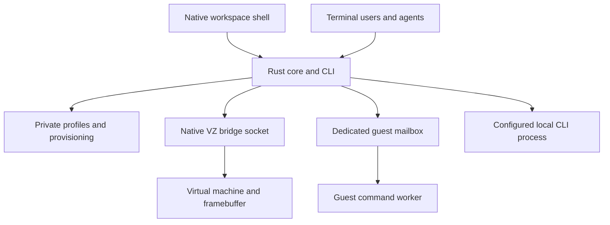
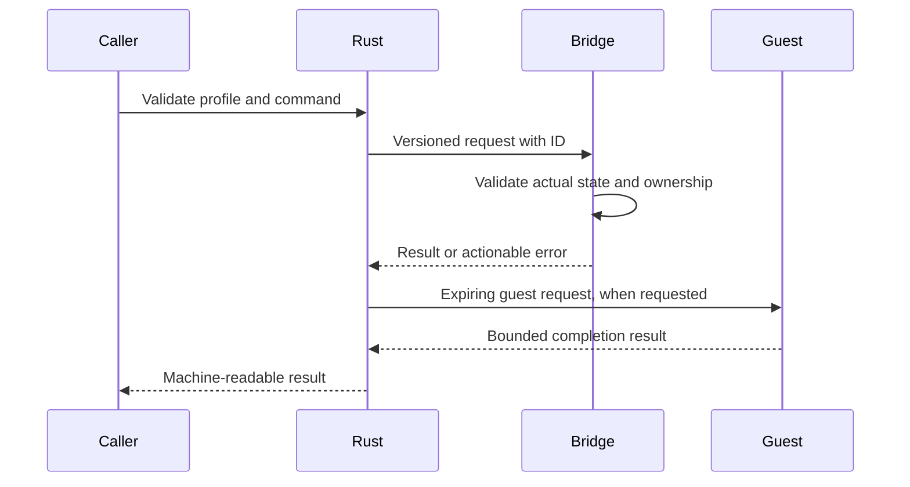
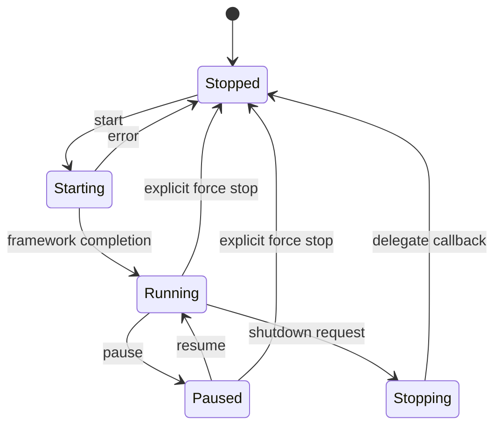

# HarborVM Workspace - Plan

## Goal Capsule

Build a usable Rust-centered VM workspace for Apple Silicon with a native guest display, guest command console, and local-CLI assistant. Ship a clean public repository under taejs with incremental commits, English contribution material, and recorded functional verification. Autonomous implementation and publication are authorized; merging a PR is not.

## Product Contract

### Summary

HarborVM combines a machine library, live VM display, guest command console, and assistant in one desktop window. The Rust CLI exposes the same operations for automation. A small macOS bridge owns Apple framework objects; Rust owns durable profiles, provisioning, command transport, and assistant execution.

### Problem Frame

The predecessor is tied to private blog workflows and has a decorative interface that hides useful controls. Publishing that repository would expose unrelated operational history. The new application needs an independent codebase and runtime.

### Requirements

**Workspace**
- R1. Provide a polished dark desktop interface with a machine list, central actual VM screen, bottom guest command console, and right assistant panel.
- R2. Support named Linux profiles with persisted CPU, memory, disk, kernel, initrd, and assistant settings; show actual state and useful failures.
- R3. Provide start, graceful stop, pause, resume, explicit force stop, and guest screenshot/input operations through the desktop and CLI.
- R4. Run guest commands with argument boundaries, bounded output, timeout, completion status, and no automatic retry after uncertain execution.
- R5. Connect the assistant to an installed local CLI, show output and errors, and allow cancellation. Do not introduce API keys or silently execute assistant text as commands.

**Isolation and delivery**
- R6. Send input only to the VM view. Do not post host-global events or synchronize the clipboard.
- R7. Keep existing machines and operational data untouched. Use a separate runtime and refuse concurrent ownership of the same profile or disk.
- R8. Publish only new product source, original assets, and English docs; include license, contribution and security policies, issue/PR templates, build instructions, and CI.
- R9. Make small, meaningful English commits after verified units. Audit all published history for private material and dependency licenses.
- R10. Include a usable browser automation workstation by default: headed Chrome, Python, Node.js and Playwright, persistent guest browser data, and a visible web page in the actual VM display (session-settled: user-directed, 2026-10-27). Keep private publishing code, accounts and schedules out of the distribution.
- R11. Let the assistant select existing Codex CLI, Ollama, or an OpenAI-compatible chat API, with configurable model and endpoint (session-settled: user-approved, 2026-10-27). Support continuing a conversation, streaming and cancellation. Do not create or silently reuse a paid API credential. Use Ollama's public chat/API documentation as a reference; retain an original native UI unless source reuse is separately justified.

### Scope Boundaries

The first release runs Linux guests on Apple Silicon/macOS 14+. Existing macOS guests remain untouched; creating macOS or Windows guests, snapshot chains, host filesystem browsing, automatic agent tool execution, and cloud orchestration are deferred. The console runs guest commands; an interactive PTY is a later feature and must not be implied by the interface.

### Assumptions

The project name is HarborVM. Orca means the open-source edvin/orca container desktop for visual inspiration; this is an assumption, not an identity claim. Use original layouts/assets, with references documented. Both edvin/orca and andrewmcoupe/orca are verified MIT references; no code or assets are copied. A fresh tiny test guest can use cached public Ubuntu downloads and at most 2 GB RAM; no production disk clone is needed.

## Planning Contract

### Key Technical Decisions

- KTD1. Use Rust for the core library and CLI, with a narrow Swift/AppKit/SwiftUI bridge for Virtualization.framework and native rendering (session-settled: user-directed — chosen over retaining the Swift/Python product architecture: Rust must own meaningful application behavior).
- KTD2. Use one native workspace process owning all opened profiles and their native VZ views, with a private Unix socket routing requests by profile ID. Switching profiles selects an in-process native view; no view crosses a process boundary. Rust validates profiles and operations and launches the packaged bridge; the bridge reports actual framework state and rejects invalid transitions. Avoid a general-purpose background service.
- KTD3. Keep profiles under an app-specific user data directory, with restrictive permissions and atomic writes. Acquire nonblocking locks on profile and disk before opening it; reject symlinks in mutable protocol locations, bound messages, and validate identifiers. The disk lock complements rather than replaces the profile lock.
- KTD4. Provision from checksum-verified official Ubuntu ARM64 cloud artifacts into a fresh directory. Generate a fresh cloud-init seed and generic Python guest worker; never import predecessor account data or business workflows. Use explicit cached/fsync storage settings based on predecessor M5 validation.
- KTD5. Use a dedicated virtiofs mailbox for guest commands and results; expose only that directory writable and the worker kit read-only. A tiny generic Python worker is bootstrapping glue. Requests carry unique IDs and expiry, replies are bounded, and timed-out commands report unknown outcome unless the guest confirms termination.
- KTD6. Invoke assistant programs with explicit argv and prompt via stdin or a documented argument, never via shell interpolation. Default to a configured Codex CLI when installed, preserve its ordinary authentication, and use a read-only sandbox. No credential files enter the repository or prompt context. A local echo adapter is test-only, never described as AI verification.
- KTD7. Keep dependencies small: serde/serde_json for versioned data, libc for OS primitives, and limited helpers only when they replace risky bespoke code. Rust handles checksums and provisioning orchestration; platform utilities may perform archive/kernel conversion with documented checks.

### High-Level Technical Design

These diagrams describe responsibility boundaries; exact module interfaces may change during implementation.

### Risks and Decisions

A local VM app is not a security boundary against other processes owned by the same host user. Mailbox input is guest-controlled and must never cause arbitrary host file access. Local assistant output is untrusted text and is displayed only. Do not automatically share guest files with an assistant. Non-cooperating hypervisors may not honor advisory disk locks; refuse known active ownership and document the limit. Graceful shutdown can remain pending; preserve that state and expose explicit force stop.

## Implementation Units

### U1. Repository and core profiles
- Requirements: R2, R7–R9; KTD1–KTD3, KTD7.
- Files: `Cargo.toml`, `src/lib.rs`, `src/profile.rs`, `src/main.rs`, `.gitignore`, `LICENSE`.
- Approach: Establish a separate repository, typed configuration, validation, atomic profile creation, CLI help and JSON errors. Bootstrap main with project metadata then implement on a feature branch.
- Tests: Reject traversal/invalid identifiers, duplicate profiles, malformed config, and symlink targets; round-trip valid configuration. Verify no overwrite on failed creation.

### U2. Native VM ownership and control
- Dependencies: U1.
- Requirements: R1, R3, R6, R7; KTD1–KTD3.
- Files: `platform/macos/`, `src/bridge.rs`, `scripts/build-macos.sh`.
- Approach: Build and sign a native bridge with private socket control, real VZ state, framebuffer, input injection scoped to the view, and disk/profile locks.
- Tests: Invalid transitions fail; a second process cannot open a locked profile/disk; stale socket handling cannot delete another owner's socket. Boot a fresh test guest, pause/resume/shutdown it, and capture its view. Compare host pointer and clipboard before/after guest input.

### U3. Provisioning and guest command execution
- Dependencies: U1, U2.
- Requirements: R2, R4, R7; KTD4, KTD5.
- Files: `src/provision.rs`, `src/guest.rs`, `guest/`, `tests/`.
- Approach: Verify Ubuntu artifacts, prepare a fresh disk and cloud-init seed, install a generic worker, and provide guest command/results with expiry and bounded output.
- Tests: Corrupt checksum never produces a bootable profile; preparation refuses an existing disk; expired requests do not execute; symlink replies are rejected; actual guest returns Unicode argv and nonzero exit status; timeout does not auto-retry.

### U4. Local assistant execution
- Dependencies: U1.
- Requirements: R5; KTD6.
- Files: `src/assistant.rs`, `tests/assistant.rs`, `docs/assistant.md`.
- Approach: Configure explicit program/argv, stream output, retain exit errors, and cancel process groups. Include an installed Codex adapter with no new API keys.
- Tests: Missing executable and authentication failure are visible; metacharacters remain prompt data; output caps and cancellation work. Verify a real installed CLI response separately from deterministic fixtures.

### U5. Desktop workspace experience
- Dependencies: U2–U4.
- Requirements: R1–R6.
- Files: `platform/macos/Workspace.swift`, `platform/macos/Model.swift`, `docs/images/`.
- Approach: Original graphite workspace with clear hierarchy, compact machine sidebar, true guest display, guest command history, resizable assistant pane, settings and empty/error/loading states. Desktop controls use the same Rust CLI contracts. Closing a window keeps guests alive and supports reopening; quitting is refused while any guest is active, with guidance to shut down first.
- Tests: Inspect actual app screenshots at minimum/default sizes; verify create/select/start/pause/resume/stop, guest command output, assistant response and cancel, focus, keyboard navigation, offline states, close/reopen while running, and refusal to quit with an active guest. Never use a mock screenshot as runtime proof.

### U6. Open-source release and verification
- Dependencies: U1–U5.
- Requirements: R8, R9.
- Files: `README.md`, `CONTRIBUTING.md`, `SECURITY.md`, `CODE_OF_CONDUCT.md`, `docs/`, `.github/`.
- Approach: Document architecture, setup, capabilities and limits, original design references, licensing, security model and contribution standards. Build CI for portable Rust checks and macOS bridge compilation. Audit history, create public taejs repository, push main bootstrap and feature branch, open a PR, and inspect CI.
- Tests: Follow clean build instructions; run formatting/lints/unit/integration checks; confirm no private runtime, personal paths, tokens or proprietary assets are tracked. Verify repository owner/visibility and report CI outcome.

### U7. Browser workstation defaults
- Dependencies: U3, U5.
- Requirements: R1, R4, R6, R7, R10.
- Files: `guest/setup.sh`, `guest/welcome.html`, `scripts/build-macos.sh`, `src/provision.rs` (packaged guest assets only).
- Approach: Install Chrome from Google's HTTPS distribution, Ubuntu Python/Node.js and an isolated Playwright environment; open an original local welcome page in headed Chrome at desktop login. Add a guest browser launcher usable by the console. Retry interrupted setup on the next boot and retain diagnostic access during setup. Keep ordinary-user browser sandboxing enabled.
- Verification: Real new guest shows a web page in the native display; guest process argv has no headless/no-sandbox flags; Python Playwright connects to the guest-only browser debugging endpoint, opens a disposable page and reads it; persistent profile survives restart. Package installation is verified live rather than mocked.

### U8. Assistant provider connections
- Dependencies: U4, U5.
- Requirements: R5, R11.
- Files: `src/assistant.rs`, `src/assistant_api.rs`, `src/profile.rs`, `src/main.rs`, `src/lib.rs`, `Cargo.toml`, `Cargo.lock`, `tests/assistant_api.rs`, `platform/macos/Model.swift`, `platform/macos/AssistantPanel.swift`, `docs/assistant.md`.
- Approach: Preserve Codex as the default; add Ollama chat and OpenAI-compatible chat-completions adapters with model discovery, conversation history, bounded streaming, explicit credential configuration and cancellation. Store only connection metadata in profiles. Never place credentials in arguments, logs or guest shares; no account creation or billable verification is authorized by this requirement.
- Verification: Existing Codex tests remain green; local HTTP fixture exercises both stream formats, request history, model lists, errors, cancellation and credential redaction. Real installed Codex verification remains separate from protocol fixtures. Record whether a real Ollama server/model is available; do not claim fixture output is model inference. Inspect the native connection picker and chat layout.

## Verification Contract

Run `cargo fmt --check`, `cargo clippy --all-targets -- -D warnings`, and `cargo test`. Run `scripts/build-macos.sh` and verify code signing/virtualization entitlement. Run guest-worker tests and fresh-guest integration checks. Record observed outputs, real screenshots, and any unverified platform limits in `docs/validation.md`. Recheck the old VM's unchanged process and availability through read-only status checks.

## Definition of Done

All six units work and are committed in reviewable increments. The actual guest lifecycle, guest command path, input isolation and local CLI assistant are verified, with real screenshots. English public documentation and CI are present. Abandoned experimental code is removed. Publication ends with a taejs public URL and open PR, or a precise authentication blocker after all independent work is complete. An incomplete simulation is never completion.
